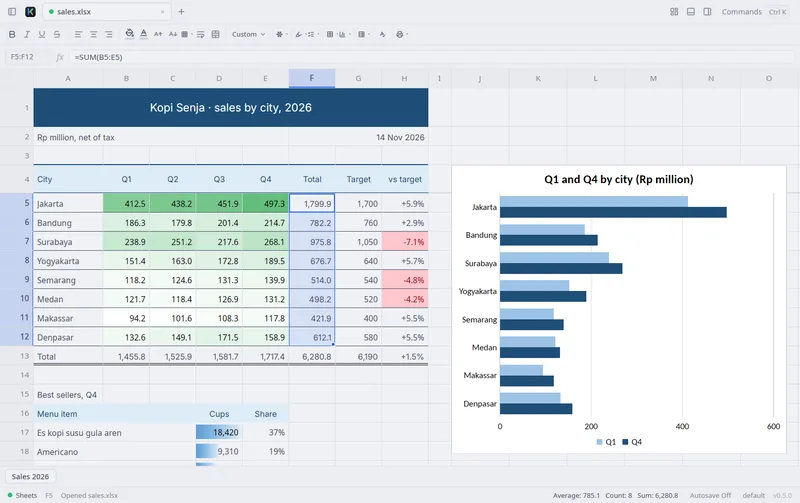
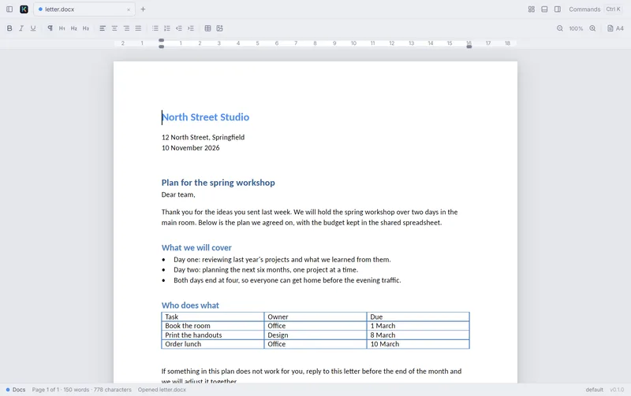
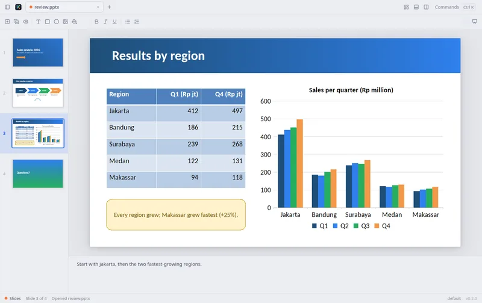
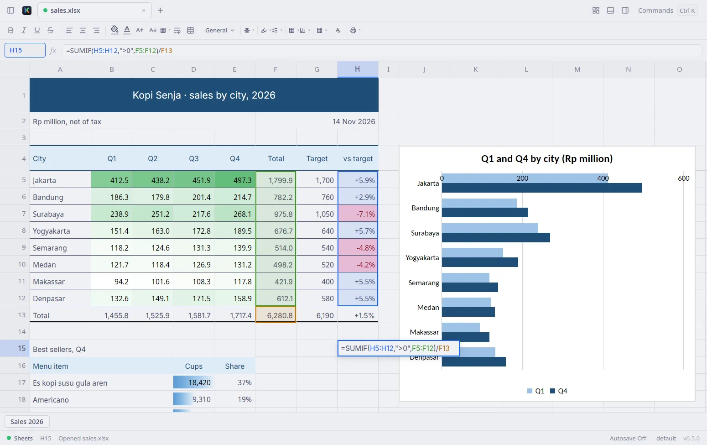

<p align="center"></p>

# Kantor

A small, fast, native office suite for Linux and macOS, written in Rust on [GPUI](https://github.com/zed-industries/zed/tree/main/crates/gpui) (the UI framework behind Zed). Three apps in one binary: **Sheets**, **Docs** and **Slides**, for `.xlsx`, `.docx` and `.pptx` files. Builds: Linux on x86_64 and aarch64 (made with [Omarchy](https://omarchy.org) in mind), and macOS on Apple Silicon and Intel.

<picture>
  <source media="(prefers-color-scheme: dark)" srcset="site/src/img/sheets-dark-1550.webp">
  
</picture>

<table>
  <tr>
    <td width="33%"><picture><source media="(prefers-color-scheme: dark)" srcset="site/src/img/sheets-dark-800.webp"></picture></td>
    <td width="33%"><picture><source media="(prefers-color-scheme: dark)" srcset="site/src/img/docs-dark-800.webp"></picture></td>
    <td width="33%"><picture><source media="(prefers-color-scheme: dark)" srcset="site/src/img/slides-dark-800.webp"></picture></td>
  </tr>
  <tr>
    <td align="center">Sheets</td>
    <td align="center">Docs</td>
    <td align="center">Slides</td>
  </tr>
</table>

Real screenshots of the current build on Linux, in the light or dark theme to match your GitHub setting. The sample files come from [site/tools/make_samples.py](site/tools/make_samples.py).

> **Status: early, all three apps work.** Sheets opens, edits and saves `.xlsx` (formulas via [IronCalc](https://github.com/ironcalc/IronCalc)) and imports `.csv`, `.ods`, `.xls` and `.xlsb`. Docs opens, edits and saves `.docx` and exports PDF. Slides opens, edits, presents and saves `.pptx` and exports PDF. Saving keeps what Kantor doesn't show yet, byte for byte. Not yet checked against a large set of real-world files; see [Known gaps](#known-gaps) and [plan.md](plan.md).

## Install

**Most people:** download Kantor from **<https://kantor.paparanai.id>** and open it.

- **macOS** (Apple Silicon and Intel, macOS 11 or later): open `Kantor.dmg` and drag Kantor to Applications. The app is signed and notarised by Apple.
- **Linux** (x86_64 or aarch64): download the AppImage, make it executable and run it. No install step:

  ```sh
  chmod +x Kantor-x86_64.AppImage
  ./Kantor-x86_64.AppImage budget.xlsx
  ```

  Most file managers can also mark the file as executable (Properties → Permissions) and open it with a double-click. The AppImage needs glibc 2.39 or newer (Ubuntu 24.04, Debian 13, Fedora 40, current Arch or later) and FUSE 3; without FUSE, run it with `--appimage-extract-and-run`. It doesn't add a launcher to your app menu; the install script below does.

The same files are on every [GitHub Release](https://github.com/dzulfikar08/kantor/releases/latest): `Kantor.dmg`, `Kantor-x86_64.AppImage`, `Kantor-aarch64.AppImage`, plus versioned copies and `SHA256SUMS`. Changes per release: [CHANGELOG.md](CHANGELOG.md).

**From a terminal** (Linux or macOS, no compiling, no sudo):

```sh
curl -fsSL https://raw.githubusercontent.com/dzulfikar08/kantor/main/scripts/install.sh | sh
kantor budget.xlsx
```

This installs the rolling **nightly** build of `main`. Pin a tagged release with `curl -fsSL …/install.sh | KANTOR_VERSION=v0.2.0 sh` (macOS builds start with v0.2.0). On Linux it installs `~/.local/bin/kantor`, a **Kantor** launcher (the suite's Home screen) and a **Kantor Sheets** launcher. On macOS it installs `~/Applications/Kantor.app` and links `~/.local/bin/kantor` to it (the nightly is Apple Silicon only and not notarised; tagged releases are universal and notarised). If `~/.local/bin` is not on your `PATH`, the script prints the line to add for your shell. On macOS, the `Ctrl` shortcuts below are `⌘`.

**Uninstall:** delete the AppImage, or drag Kantor from Applications to the Bin. To remove what the install script installed:

```sh
curl -fsSL https://raw.githubusercontent.com/dzulfikar08/kantor/main/scripts/install.sh | sh -s -- --uninstall
```

Settings (`~/.config/kantor`) and the saved session (`~/.local/state/kantor`) are kept; delete them by hand if you want them gone.

Arch Linux: a PKGBUILD for a future `kantor-bin` AUR package lives in [packaging/aur/](packaging/aur/); it is not published yet.

## What works

`kantor` opens the Home screen (Docs · Sheets · Slides); `kantor file.xlsx` (or `.docx`, `.pptx`) opens the file, and `kantor --sheets`, `--docs` or `--slides` starts a new document. Documents open in tabs that you can split side by side; Find & Replace (`Ctrl F` / `Ctrl H`) and undo work the same in all three apps.

### Sheets

- **Formatted workbooks look as they do in Excel:** cell fills (theme and indexed colours), text colour, font size and family, bold/italic/underline, horizontal and vertical alignment, wrapped text, borders (thin to thick, double, dotted, dashed), merged cells and gridlines off per sheet. The toolbar and palette set fill and text colour, font size, borders, wrap, merge & center and alignment, each as one undo step.
- **Number formats as Excel shows them** (`crates/kantor_numfmt`): thousands separators, decimals, percentages, currency, dates and times, fractions, elapsed time (`[h]:mm:ss`), conditions, colours (`[Red]`), text sections and accounting fill. Locale tags work: `[$Rp-421]#,##0` shows `Rp1.500.000` with Indonesian separators, and `[$-421]d mmmm yyyy` shows `17 Agustus 2025`.
- **Conditional formatting as Excel shows it** (display; rules are edited in Excel for now): highlight rules (greater than, between, equal to, text that contains / begins / ends with, dates in a period, duplicates, blanks, errors), formula rules, top/bottom N and %, above/below average, 2- and 3-colour scales, data bars (with a negative axis) and icon sets (arrows, traffic lights, flags, symbols, stars, quarters, ratings), with priority and *Stop If True*. Rules follow edits and recalculation, are worked out only for the cells on screen, and are saved unchanged.
- **Formulas** through IronCalc. While you type one, clicking or arrowing to cells inserts their references, which are coloured in the editor and outlined in the same colour on the grid; `F4` cycles `$` anchors, and typing a function name lists matching functions.

  <picture>
    <source media="(prefers-color-scheme: dark)" srcset="docs/images/sheets-formula-dark.webp">
    
  </picture>

- **Grid work:** select rows, columns or everything, `Ctrl`+arrows to the edge of the data, fill handle and `Ctrl D` / `Ctrl R` (series continue), autofit columns, insert/delete rows and columns, freeze panes, copy and paste ranges as tab-separated text. The status bar shows Sum, Average and Count of the selection.
- **Big workbooks:** files open in the background with a Cancel button and show the values Excel saved instead of recalculating on open. A 180,000-row, 32 MB `.xlsx` uses about 323 MB with the app open (377 MB after a full recalculation), and closing it gives the memory back. A real workbook with 767,000 formulas recalculates in about 3 seconds (patched IronCalc with cached lookups). Workbooks with more than 50,000 formulas switch to **manual calculation**: `F9` recalculates everything (`Shift F9` the sheet), and the palette switches between automatic and manual.
- **Saving keeps what Kantor doesn't edit:** Excel tables, chart sheets, charts, pictures, sparklines, data validation and comments are carried over, and their references follow inserted or deleted rows and columns.
- Imports `.csv`/`.tsv`, `.ods`, `.xls` and `.xlsb` (saving those goes to a new `.xlsx`).

### Docs

`.docx` editing: paragraph and character styles, headings, fonts, colour, alignment, spacing and indents, bulleted and numbered lists (9 levels, with Word's Enter/Tab/Backspace behaviour), tables with merged cells and borders, inline pictures, page breaks, hyperlinks, page setup (A4, Letter, Legal, A5, F4; margins in cm) with a ruler, and a word count. *Export as PDF…* in the palette writes a PDF with the same layout as the screen (fonts embedded, text selectable). Floating images, shapes, fields and other parts Kantor can't show yet are kept as placeholders and saved unchanged.

### Slides

`.pptx` editing: text boxes and placeholders (with the master's bullets, numbering and spacing), shapes and pictures you can move, resize, rotate and flip, fill and outline, a thumbnail strip to reorder slides, speaker notes, copy and paste of shapes, and a slide show with notes (`F5`). Slides are drawn as in PowerPoint: all 187 preset shapes (arrows, chevrons, callouts, flowchart symbols…) and freeform shapes, gradient and picture fills, transparency, dashed lines and arrowheads, groups, tables with PowerPoint's table styles, SmartArt, and charts (column, bar, line, area, pie, doughnut, scatter and combinations) from the values saved in the file. *Export as PDF…* writes one page per slide, hidden slides left out. Tables, charts and SmartArt are shown but can't be edited yet; their XML is saved unchanged.

## Keyboard

On macOS, use `⌘` where this table says `Ctrl` (`Ctrl Tab` stays).

| Action | Keys |
|---|---|
| Move | arrows, `Tab`/`Shift+Tab`, `Home`/`End`, `PgUp`/`PgDn` |
| Edit a cell | just type (replaces), or `Enter`/`F2`/double-click (keeps content) |
| Commit / cancel | `Enter` (moves down) / `Esc`; clicking another cell also commits |
| Clear a cell | `Delete` |
| Anchor a reference / recalculate | `F4` while editing a formula / `F9` |
| Undo / redo | `Ctrl Z` / `Ctrl Shift Z` |
| Find / replace | `Ctrl F` / `Ctrl H` |
| Open / Save / Save as | `Ctrl O` / `Ctrl S` / `Ctrl Shift S` |
| Command palette | `Ctrl K` (or `Ctrl Shift P`) |
| New spreadsheet / document / presentation | `Ctrl N` / `Ctrl Shift N` / `Ctrl Alt N` |
| Slide show | `F5` (`Shift F5` from the current slide) |
| Close pane / close tab | `Ctrl W` / `Ctrl Shift W` |
| Split right / down | `Ctrl \` / `Ctrl Alt \` (drag the divider to resize) |
| Sidebar / inspector | `Ctrl Shift E` / `Ctrl Shift I` (drag the edge to resize) |
| Theme / UI font | `Ctrl K` → *Choose Theme…* / *Choose UI Font…* |
| Next / previous tab | `Ctrl Tab` / `Ctrl Shift Tab` |
| Quit | `Ctrl Q` |

Edits happen in the cell itself (synced live with the formula bar). With an input method such as fcitx5, press `Enter` first, then compose.

By default the UI follows your Omarchy theme (live-reloading on `omarchy theme set`); *Choose Theme…* offers your Omarchy themes plus 900+ Ghostty themes. The UI font is SF Pro when installed (never bundled), else Inter / Adwaita Sans. Open tabs, splits and panel sizes are restored on the next launch. Settings: `~/.config/kantor/settings.toml`; session: `~/.local/state/kantor/workspace.json`.

## Command line

```sh
kantor convert report.docx report.pdf          # also .ods/.xls → .xlsx, a sheet → .csv
kantor convert deck.pptx deck.pdf              # one page per slide, hidden slides left out
kantor convert -o out/ --to pdf a.docx b.docx
kantor pdf merge a.pdf b.pdf -o both.pdf       # also split, extract, delete, reorder, rotate,
                                               # info, images, watermark, page-numbers, compress
```

Neither opens a window.

## AI agents (MCP)

`kantor mcp` is an [MCP](https://modelcontextprotocol.io) server: Claude Code, Claude Desktop,
Cursor and other agents can read and edit the documents open in the **running** Kantor while you
watch. Every change is one undo step (`Ctrl Z` takes it back), the changed cells, paragraphs or
slide are selected, and the status bar says what the agent did. Nothing is saved until the agent
(or you) saves.

```sh
claude mcp add kantor -- kantor mcp      # Claude Code (palette: "Copy MCP Setup for Claude Code")
kantor mcp --print-config                # JSON for Claude Desktop, Cursor and others
```

```json
{ "mcpServers": { "kantor": { "command": "/home/you/.local/bin/kantor", "args": ["mcp"] } } }
```

If Kantor isn't running, the first tool call starts it (`kantor mcp --no-launch` returns an error
instead). Tools: `list_documents`, `open_document`, `new_document`, `save_document`,
`activate_document`, `get_selection`; Sheets `sheets_read_range`, `sheets_write_range`,
`sheets_select`, `sheets_format`, insert/delete rows and columns; Docs `docs_get_paragraphs`,
`docs_insert_paragraphs`, `docs_replace_paragraph`, `docs_delete_paragraphs`, `docs_find_replace`;
Slides `slides_list`, `slides_add_slide`, `slides_set_shape_text`, `slides_delete_slide`,
`slides_set_notes`, `slides_go_to`. The app listens only on a private Unix socket
(`$XDG_RUNTIME_DIR/kantor/`, on macOS `~/Library/Application Support/Kantor/run/`), readable by
you alone.

## AI features (optional) and privacy

AI is **off** until you turn it on in `Ctrl K` → *AI Settings* and choose a provider: Anthropic, OpenAI, OpenRouter, Groq, DeepSeek, Google Gemini, any OpenAI-compatible server, or **Ollama** running on your own computer (nothing leaves it). Kantor has no AI service of its own: your data goes **only to the provider you chose**, and only when you run an AI command. Each command sends only what it needs:

- *Ask AI for a Formula…* (Sheets): the column headers, up to 20 sample rows near the selection and the active cell's address — never the whole sheet;
- *Explain This Formula* (Sheets): the formula and the column headers;
- *Rewrite / Translate Selection…* (Docs): the selected paragraphs' text.

API keys are stored in the system keychain (Secret Service on Linux, Keychain on macOS); if none is available Kantor says so and keeps the key in `~/.config/kantor/ai-keys.toml`, readable only by you. Keys are never written to `settings.toml` or logs. What the provider does with your requests is governed by its own terms.

## Updates

Kantor downloaded from the site, the GitHub releases or the install script keeps itself up to date:

- **When it checks:** at most once a day, at launch, and when you choose `Ctrl K` → *Check for Updates…*. A check fetches a small manifest from `https://kantor.paparanai.id/update/stable.json` (redirected to the GitHub release) and sends **only Kantor's version and your OS and CPU type**, in the User-Agent (`Kantor/0.2.1 (linux; x86_64)`). No identifier, no usage data, nothing about your files. `kantor mcp`, `kantor convert` and `kantor pdf` never check.
- **How it's protected:** the manifest is signed (Ed25519) and Kantor checks the signature with a key built into the app before trusting anything in it; every download must then match the manifest's size and SHA-256, and the new build must start and report the promised version before it is used. On macOS the new `Kantor.app` must also pass `codesign` (Developer ID team `F6Q6UFUK69`) and Gatekeeper (notarised) checks.
- **What you see:** nothing while it downloads in the background. When the new version is ready, the status bar says *Kantor X.Y.Z is ready — Restart to update*. Click it (or `Ctrl K` → *Restart to Update*): Kantor asks about unsaved documents as when quitting, installs the update and reopens. If you just quit, the update is installed then and you get it next time.
- **How each install updates:**
  - **macOS app** (`Kantor.dmg` or the install script): the new notarised `Kantor.app` replaces the old one where it is. If Kantor can't write there (an Applications folder you don't own), it offers the download page instead.
  - **AppImage:** the new AppImage replaces the file you run, under the same name.
  - **Install script on Linux** (`~/.local/bin/kantor`): the binary, launchers and icons are replaced.
  - **Packages and source builds** (AUR, `cargo build`, …) are never changed: Kantor only tells you a new version exists. Update those the usual way.

  Each replacement is all-or-nothing: if any step fails, the old version stays as it was.
- **Channels:** releases follow `stable`; nightly builds (the install script's default) follow `nightly`. The nightly macOS build is not notarised, so on macOS nightly Kantor only tells you about new nightlies.
- **Turn it off** in `~/.config/kantor/settings.toml`; Kantor then makes no update requests at all, not even from the palette:

  ```toml
  [update]
  enabled = false
  # channel = "nightly"   # or "stable"; unset follows the build
  ```

For testing, `KANTOR_UPDATE_URL` replaces the manifest URL and `KANTOR_UPDATE_CURRENT=0.1.0` makes Kantor compare as if it were that version; signatures, checksums and code-signing checks still apply.

## Known gaps

- Not yet checked against a large set of real-world files; expect layout differences from Excel, Word and PowerPoint.
- Sheets: no sort, filter, charts on the grid, printing or autosave; every row is drawn at the same height (heights from the file are kept). Macros and pivot tables are not carried over on save (Kantor says so). IronCalc can't evaluate 3-D references (`SUM(Jan:Mar!B2)`) or structured table references (`Sales[Units]`). `.ods`, `.xls` and `.xlsb` are import-only, and `kantor convert` can't turn a spreadsheet into PDF. Conditional formatting can't be created or edited in Kantor yet, its borders aren't drawn, data bars ignore minimum/maximum lengths, and "between" date periods don't highlight.
- Docs: headers and footers, footnotes, fields and floating objects are kept in the file but shown only as placeholders and left out of the PDF; table rows don't split across pages; no spell check. Files with tracked changes, comments or a table of contents are saved under a new name.
- Slides: the content of tables, charts, groups and SmartArt can't be edited; chart types other than those above show a placeholder; on screen, rotated text stays upright (the PDF turns it).
- The Linux builds need glibc 2.39 or newer.

## Building

All builds run on **GitHub Actions** (`ubuntu-24.04-arm`, `ubuntu-24.04` and `macos-15`); contributors don't need a powerful machine. If you do want to build locally:

```sh
./scripts/ci-deps.sh            # Ubuntu packages; on Arch: wayland libxkbcommon vulkan-icd-loader fontconfig; macOS needs only Xcode's tools
cargo run -p kantor -- file.xlsx
cargo test --workspace
```

Expect `target/` to reach 10–20 GB and the first build to need plenty of RAM.

## Layout

```
crates/
  kantor         binary: CLI (`convert`, `pdf`, `mcp`), suite shell (tabs, Home, palette, status bar)
  kantor_ui      design system: metrics, colour tokens from Omarchy, cached views
  kantor_core    shared non-GPUI pieces (fuzzy search, find, settings, session)
  kantor_ai      AI providers, streaming HTTP clients, prompts, keychain (no GPUI)
  kantor_theme   Omarchy palette parser (no GPUI)
  kantor_update  in-app updates: signed manifests, download, verify, swap the install (no GPUI)
  kantor_mem     gives freed heap memory back to the system after big documents close (no GPUI)
  kantor_pdf     PDF page tools behind `kantor pdf` (no GPUI)
  sheets_engine  IronCalc wrapper: open/save xlsx, imports, part preservation (no GPUI)
  kantor_numfmt  Excel number formats, adapted from GridCraft (MIT OR Apache-2.0; no GPUI)
  sheets_ui      grid, formula bar, sheet tabs
  docs_engine    document model, styles, undo, .docx read/write and preservation (no GPUI)
  docs_layout    parley text layout into pages (no GPUI)
  docs_pdf       .docx → PDF with the same layout as the screen
  docs_ui        page view, caret, selection, IME, toolbar, ruler
  slides_engine  slide/shape/text model, undo, .pptx read/write and preservation (no GPUI)
  slides_scene   slide → display list (paths, gradients, pictures, glyph runs), shared by screen and PDF
  slides_pdf     slide scenes → PDF (krilla)
  slides_ui      slide canvas, thumbnails, notes, slide show
vendor/
  gpui-pre-wgpu  GPUI's wgpu renderer (Linux) with memory patches for low-memory GPUs
  ironcalc_base  IronCalc's engine with cached lookups for large workbooks (KANTOR_PATCHES.md)
  ironcalc       IronCalc's xlsx reader and writer, patched to match (KANTOR_PATCHES.md)
site/            the download site (kantor.paparanai.id); site/tools/ takes the screenshots
```

## Credits

- [IronCalc](https://github.com/ironcalc/IronCalc) (MIT OR Apache-2.0) does the formulas and xlsx import/export; Kantor carries patched copies in `vendor/`.
- [GPUI](https://github.com/zed-industries/zed) (Apache-2.0) draws the UI, through [GPUI Kit](https://github.com/longbridge/gpui-kit) (Apache-2.0).
- Cell values are formatted by `crates/kantor_numfmt`, adapted from [GridCraft](https://github.com/storytold/gridcraft)'s `gridcraft-numfmt` (MIT OR Apache-2.0, by the ArtCraft Team and the GridCraft contributors); see its [PROVENANCE.md](crates/kantor_numfmt/PROVENANCE.md).
- [parley](https://github.com/linebender/parley) lays out text and [krilla](https://github.com/LaurenzV/krilla) writes the PDFs.

Third-party notices are in [NOTICE](NOTICE). Every download also ships `THIRD_PARTY_LICENSES.txt` with the licence texts of all linked crates (generated by `scripts/third-party-licenses.py`).

The shell's structure and styling follow [Voltrus Tools](https://github.com/VoltrusID/voltrus-explorers) (see `docs/reference-voltrus-tools.md`).

## License

[GNU Affero General Public License v3.0 or later](LICENSE) (AGPL-3.0-or-later). Modified versions, including ones offered over a network, must publish their source under the same licence.
